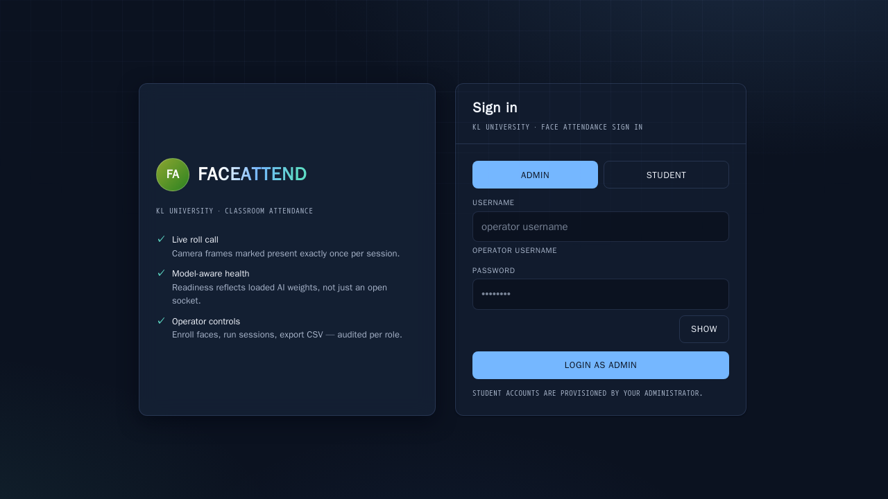
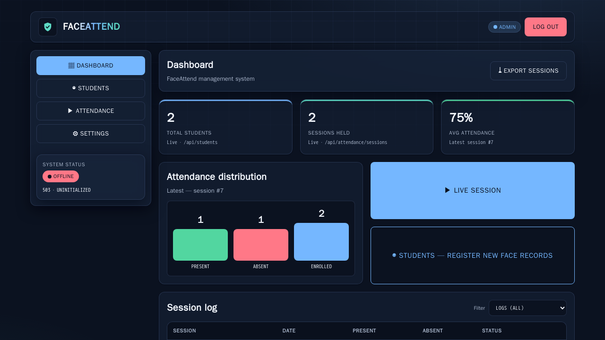
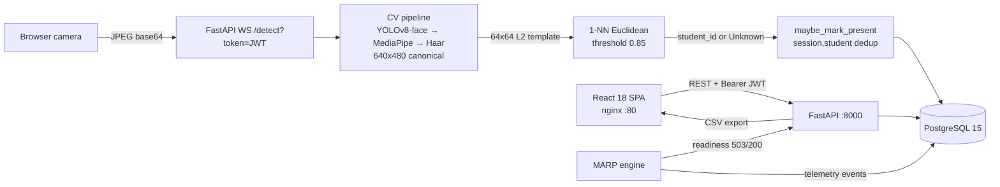

# FACEATTEND — Edge AI Face Attendance with MARP

Classroom face attendance with a model-aware backend: enroll students with a
camera, run a live session, and watch faces turn into `Present` records —
while the API refuses traffic until its AI models are genuinely loaded.

> **Template note.** This repository is maintained as a reusable starting
> point. Branding is white-label (`REACT_APP_ORG_NAME`, see
> [Configuration](docs/CONFIGURATION.md)); demo credentials below are
> **local-only development defaults**, never production secrets. No license
> has been selected yet — see [Contributing](CONTRIBUTING.md) and the D2
> report before redistributing.




## Contents

- [Features](#features)
- [Architecture](#architecture)
- [Technology stack](#technology-stack)
- [Prerequisites](#prerequisites)
- [Quick start](#quick-start)
- [Configuration](#configuration)
- [Workflows](#workflows)
- [Computer vision pipeline](#computer-vision-pipeline)
- [MARP readiness](#marp-readiness)
- [Telemetry and fault testing](#telemetry-and-fault-testing)
- [Database](#database)
- [Testing](#testing)
- [Troubleshooting](#troubleshooting)
- [Known limitations](#known-limitations)
- [Contributing](#contributing)
- [Citation / research](#citation--research)

## Features

- **Admin and student authentication.** JWT login with role enforcement on
  every protected route; students can only read their own record.
- **Student enrollment.** 1–8 face images per student → one averaged,
  L2-normalized 64×64 grayscale template stored as JSONB. Invalid images are
  rejected with `422` (bad base64, no usable face); nothing is stored.
- **Live attendance sessions.** WebSocket frame pipeline
  (`/api/v1/attendance/ws/detect?token=JWT`, ack-or-1s backpressure),
  canvas overlay with bounding boxes, live roll call, exactly-once marking
  per session (`marked_memory` + idempotent DB writes + FK constraint).
- **Camera-free HTTP detection.** `POST /api/v1/attendance/detect` (JSON) and
  `POST /api/v1/attendance/detect/annotated` (returns an annotated JPEG)
  share the live pipeline — no camera required.
- **Attendance management.** Session log, per-session roster with
  present/absent counts, manual override, `GET /export.csv` roster download
  and a client-side sessions export.
- **Student portal.** Roll-number login, personal history, attendance
  percentage; no administrative surface.
- **MARP readiness.** `GET /api/v1/marp/healthz/readiness` returns 503 with an
  explicit `marp_state` until weights + DB are ready, then 200. Single-flight
  background load, stable failure kinds (`FAILED_DB/MODEL/TIMEOUT/BUSY`),
  explicit operator recovery.
- **Selected fault testing.** In-situ chaos knobs (DB drop, model unload,
  probe refusal, latency, VRAM exhaustion, model stall, frame drop) plus a
  `tests/fault_injection.py` AC-2 harness for disposable stacks.
- **Telemetry.** Every MARP/chaos transition is logged async to
  `marp_telemetry`; `GET /api/v1/marp/telemetry/export` (admin) downloads
  flattened `marp_research_data.csv`.
- **Experimental / incomplete (not production paths):** Kubernetes manifests
  (no Postgres manifest, no published images, unresolved frontend API-URL
  strategy), a dead Vite tree (`src/App.jsx`, `src/pages/`, … — unshipped,
  see `docs/DECISIONS.md` D-09).

## Architecture



Service topology (`docker-compose.yml`): `db` (postgres:15-alpine, init from
`database/schema.sql`, health-gated) → `backend` (MARP-gated healthcheck;
`frontend` waits on `backend: healthy`) → `frontend` (nginx serving the CRA
build). `backend-dev` (source mount + reload, `development` profile) is
dev-only. See [docs/ARCHITECTURE.md](docs/ARCHITECTURE.md) for the full data
flow, probe mapping, and persistence map.

## Technology stack

| Layer | Technology (pinned versions) |
|---|---|
| AI core | ultralytics **8.0.227** (YOLOv8-face) → mediapipe **0.10.9** → Haar fallback (OpenCV **4.8.1.78** pair, 640×480), CPU template 64×64 L2-norm, 1-NN ReID |
| Backend | Python **3.11-slim**, FastAPI **0.104.1**, SQLAlchemy **2.0.23**, `python-jose[cryptography]` **3.3.0** + `passlib/bcrypt` **1.7.4/4.0.1**, `psycopg2-binary` **2.9.9**, NumPy **1.26.4** |
| DB | PostgreSQL **15-alpine** (`students`, `attendance_sessions`, `attendance_records`, `detection_events`, `users`, `marp_telemetry`) |
| Frontend | React **^18.2.0**, react-scripts **5.0.1**, Node **18-alpine** build → nginx; TypeScript override **4.9.5** |
| Tests | pytest **9.1.1** + httpx **0.27.2** (backend), Playwright **1.49.1** on `playwright/python:v1.49.0-jammy` (browser) |
| Edge/Cloud | Docker Compose (dev + prod override), Kubernetes (explicitly incomplete), GitHub Actions CI |

Pinned manifests: `backend/requirements.txt`, `backend/tests/requirements.txt`,
`frontend/package-lock.json`, `frontend/tests-browser/requirements.txt`.

## Prerequisites

- Docker Engine + Docker Compose plugin, Git, a modern browser.
- ~4 GB free disk for images; first backend build downloads the pinned
  Python stack including PyTorch (~2 GB, one time, cached afterwards).
- Model weights: YOLOv8n is pre-warmed into the backend image; `yolov8n-face.pt`
  downloads on first boot (~6 MB) unless cached — allow outbound network on
  first start, and expect a longer MARP warm-up then.
- No GPU required or used. Tested on Linux/x86_64 with Chromium.

## Quick start

```bash
git clone <your-repository-url>   # your fork or this template
cd <repository-directory>
cp .env.example .env              # review it; dev defaults are LOCAL-ONLY
docker compose up -d --build
# Watch MARP warm up: 503 LOADING_WEIGHTS → 200 READY (can take minutes
# on first boot while weights download; fast afterwards).
curl -i http://localhost:8000/api/v1/marp/healthz/readiness
# Frontend:
open http://localhost:3000       # admin login → Dashboard
# Dev live-reload backend instead of the baked image:
docker compose --profile development up -d --build
# Stop (keeps the pgdata volume):
docker compose down
```

Login with the operator account (development seeding; **local demo only** —
see [Configuration](docs/CONFIGURATION.md#local-development-defaults)):
username `admin`, password from `ADMIN_PASSWORD` in your `.env`
(`admin123` is the documented local default — never use it beyond localhost).

```bash
# Example API flow (use the ADMIN_PASSWORD you configured):
TOKEN=$(curl -s -X POST localhost:8000/api/v1/auth/login \
  -H 'Content-Type: application/json' \
  -d "{\"username\":\"admin\",\"password\":\"$ADMIN_PASSWORD\",\"role\":\"admin\"}" \
  | python3 -c "import json,sys; print(json.load(sys.stdin)['token'])")
curl -X POST localhost:8000/api/v1/attendance/start \
  -H "Authorization: Bearer $TOKEN" -H 'Content-Type: application/json' \
  -d '{"session_name":"Morning Session"}'
curl -H "Authorization: Bearer $TOKEN" \
  localhost:8000/api/v1/marp/telemetry/export -o marp_research_data.csv
```

Production: `docker compose -f docker-compose.yml -f docker-compose.prod.yml
up -d --build` with externally supplied `JWT_SECRET`, `ADMIN_PASSWORD`,
`POSTGRES_PASSWORD`, `DATABASE_URL`. Missing/empty secrets abort before
anything starts; short or documented-default values fail application startup.

## Configuration

Full reference: [docs/CONFIGURATION.md](docs/CONFIGURATION.md). Highlights:

- `ENVIRONMENT` (`development`|`test`|`production`) is **required** — the app
  refuses to boot without an explicit value.
- White-label branding: set `REACT_APP_ORG_NAME` (uncomment in `.env`), then
  `docker compose build frontend` (CRA embeds it at build time). Default keeps
  the built-in fallback.
- API URLs are build-time args (`REACT_APP_API_URL`, default
  `http://localhost:8000`); the dev default targets a local backend.
- Face pipeline knobs: `FACE_BACKEND_ORDER=yolo,mediapipe,haar`,
  `YOLO_WEIGHTS`, `REID_THRESHOLD=0.85` (**uncalibrated research default** —
  see Limitations), `MODEL_LOAD_SECONDS=15` (attempt-timeout bound, not a wait).

## Workflows

**Administrator.** Login (`Admin` mode) → Dashboard (sessions held, enrolled,
session log, Export sessions) → Students tab (ID + name + branch, four angle
captures with retakes, *Save student & embeddings*) → Attendance tab (optional
*Session name*, *Start session* → live overlay + roll call + detection log →
*End session* → summary) → review roster, correct via override, export CSV →
Settings tab (MARP status, terminal tail, chaos drills with confirmation,
Recover).

**Student.** Login (`Student` mode, roll number + provisioned password) →
portal shows identity, percentage, per-session history. 401/403 anywhere
returns to login; students can never reach admin routes (server-enforced).

## Computer vision pipeline

Decode → canonical 640×480 → detector chain in `FACE_BACKEND_ORDER`
(YOLO conf 0.5 → MediaPipe → Haar `1.1/6/80×80`, aspect gate 0.7–1.3) →
per-box crop → 64×64 grayscale → equalizeHist → /255 → L2-normalized
4096-vector → nearest stored template by Euclidean distance, accept iff
`distance <= REID_THRESHOLD` (default 0.85). Invalid vectors (None, malformed,
NaN/inf, wrong length) fail closed to "no match". Haar cascade ships with
OpenCV and always works offline; YOLO/MediaPipe import lazily with fallback.

## MARP readiness

Boot runs a single-flight background load: real DB check first, then bounded
detector-chain init. `GET /api/v1/marp/healthz/readiness` answers **503**
(`LOADING_WEIGHTS`, `FAILED_DB`, `FAILED_MODEL`, `FAILED_TIMEOUT`,
`FAILED_BUSY`, chaos kinds with `failure_kind`) until weights **and** DB are
ready, then **200** (`READY`). Failures persist until explicit recovery
(`recover`/`reset` start one new attempt). Compose healthchecks and K8s
probes consume this endpoint so no traffic reaches a cold model.

## Telemetry and fault testing

`marp_telemetry` rows (`event_type, phase, vram_allocated_mb,
load_duration_ms, active_chaos_params`) are written by fire-and-forget daemon
inserts that never block inference. Export flattens chaos knobs to
`chaos_*` CSV columns. The Settings panel exposes DB drop, model unload,
probe refusal, latency, VRAM exhaustion, model stall, frame drop, and
recover — each a real state transition (verified 503 → 200), never a mock.
`tests/fault_injection.py` runs the AC-2 drill against disposable stacks in CI.

## Database

PostgreSQL 15. `students` (unique `student_id`, JSONB mean template);
`attendance_sessions` + `attendance_records` (pre-created `Absent` rows,
`UNIQUE(session_id, student_id)`, FKs with cascading deletes);
`detection_events`; `users` (bcrypt hashes, JWT `sub/role/exp`); `marp_telemetry`.
Fresh databases self-initialize (initdb `schema.sql` + idempotent
`create_all`, cross-process serialized by a PostgreSQL advisory lock — safe
for multi-replica first boot).

## Testing

Full matrix: [docs/TESTING.md](docs/TESTING.md). Pointers:

```bash
# Backend (isolated Postgres + pinned py3.11 env; see TESTING.md for the
# disposable-container recipe — never run against a live database):
pytest backend/tests/test_r1_security.py backend/tests/test_r2_marp.py \
  backend/tests/test_r7_dependencies.py backend/tests/test_roster_export.py \
  backend/tests/test_r9_matching.py backend/tests/test_r10_schema_concurrency.py \
  backend/tools/cv_eval/tests/test_cv_metrics.py
pytest backend/tests/test_1b_env_config.py   # repo root, needs docker CLI
# Frontend:
(cd frontend && npm ci && npm run build)
# Browser (disposable r6-* stack, synthetic data only):
bash frontend/tests-browser/run.sh          # 59 tests, tears itself down
```

Latest verified evidence (R12, recorded with exit code 0): backend **169
passed**, config **25 passed**, browser **59 passed**, production build green.
CI (`main` push/PR) runs: prod-override fail-closed check → compose build →
CV import smoke test → live stack → MARP READY poll → fault injection →
teardown. CI status is not claimed here — see the Actions tab.

## Troubleshooting

| Symptom | Likely cause / fix |
|---|---|
| Readiness stuck at 503 `LOADING_WEIGHTS` | First-boot weight download; wait, then check backend logs. Stuck past budget → explicit `FAILED_TIMEOUT`; use Recover |
| 503 `FAILED_DB` / `Database failure` | DB down or wrong `DATABASE_URL`; `docker compose ps`, check `db` health |
| Login 401/503 | Wrong credentials, or no admin seeded: set `ADMIN_PASSWORD` and restart (dev seeds on first login) |
| Camera shows "unavailable/blocked" | Browser permission or insecure context; use the HTTP `POST /detect` path instead (documented above) |
| Frontend can't reach API | Rebuild after changing `REACT_APP_API_URL` (build-time value) |
| `npm ci` fails | Delete `node_modules`, retry with Node 18; lockfile is committed — do not `npm install` over it |
| `docker compose up` port conflict | Defaults are 3000/8000; set `FRONTEND_PORT`/`BACKEND_PORT` in `.env` |

## Known limitations

- The matcher is a **raw-pixel template baseline, not a learned embedding**;
  threshold **0.85 is uncalibrated**; **no real-world accuracy (FAR/FRR),
  fairness, or liveness/anti-spoofing has been demonstrated** (photo-of-photo
  is accepted — disclosed, unmitigated).
- No labelled evaluation dataset exists in-repo; the protocol
  (`docs/CV_EVALUATION_PROTOCOL.md`) and metric harness
  (`backend/tools/cv_eval/`) are ready, data is not.
- Kubernetes manifests are explicitly incomplete; Compose is the supported path.
- Screen-reader pass and second browser engine remain future work.
- Dead Vite tree (`src/App.jsx`, `src/pages/`, …) is unshipped legacy;
  deletion/promotion is an open owner decision (D-09).
- Privacy: consent, retention, deletion, and audit policy are undecided
  (UQ-03) — do not onboard real student data without them.

## Contributing

See [CONTRIBUTING.md](CONTRIBUTING.md): branch from `main`, keep PRs focused,
run the relevant suites above, never commit secrets, data, images, model
weights, or local artifacts. UI changes must preserve the tested accessible
names (see `docs/TESTING.md` for the locked selector list).

## Citation / research

If you use this project academically, cite the repository URL and commit hash
you evaluated. A manuscript draft is tracked separately from this repo —
currently **no paper draft is committed here**. The research-ready artifacts
that do exist: pinned reproducible dependencies, MARP design + telemetry
export, the evaluation protocol, and the deterministic metric harness.
Real accuracy claims require a consented, labelled dataset and the registered
dev/holdout procedure in `docs/CV_EVALUATION_PROTOCOL.md`.
